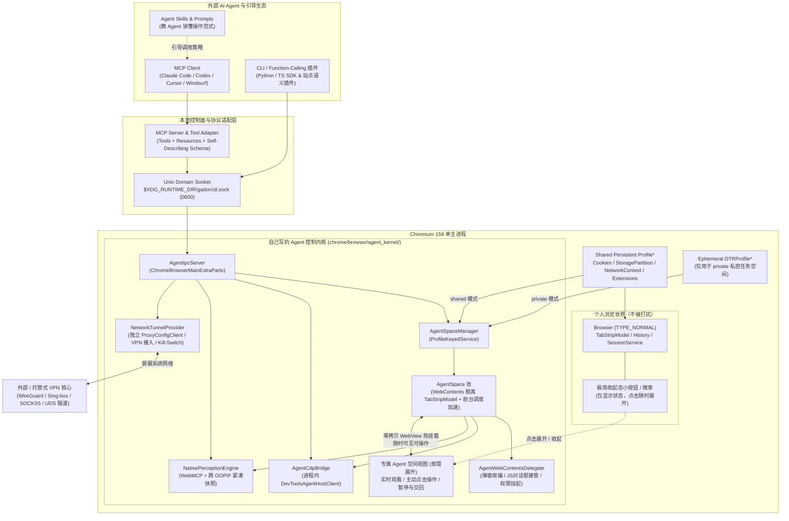

# `gador` 架构设计文档（RFC-001）

> **初衷**：因为需要一个可以介入、适合 AI 使用的浏览器，但一直没有找到自己喜欢的，所以基于 Chromium `158.0.8127.36` 自己动手写了一套方便 AI 接入和控制的浏览器。  
> **实现方式**：不重复造 HTML/CSS/JS 渲染引擎，而是在 Chromium 之上自己写了一套面向 AI Agent 的控制内核（Agent Control Kernel）。

---

## 1. 背景与产品方向

### 1.1 为什么不从零重写渲染引擎，而是「重写控制内核」？

从零编写一个兼容现代 Web（复杂 SPA、WebAuthn、Passkey、现代 TLS/HTTP3、第三方登录、各类前端框架）的渲染引擎与 JS 引擎需要数百人年的长期投入，且极易在真实站点的登录态和兼容性上崩盘——这与我们**「第一优先级：做好统一登录环境」**直接矛盾。

但传统桌面浏览器（包括 Chromium 自身的 `Browser` + `TabStripModel`）完全是为**人类单焦点视觉交互**设计的。我们要做的，是保留 Chromium 158 经过验证的渲染、网络与安全底座（Blink / V8 / NetworkContext / Profile），在 `chrome/browser/` 与 `content/browser/` 之间**独立构建一套完全面向 Agent 的控制内核 `agent_kernel`**，彻底把「人类日常浏览」与「Agent 自动执行」在控制面和界面层解耦。

### 1.2 行业方案思想拆解与本项目的差异化定位

以下横向总结 2025–2026 主流 AI 浏览器与自动化方案的核心思想（仅提炼思路），并明确本项目自己的方向：

| 参考方向 | 行业代表 | 可借鉴的核心思想 | 局限性（我们要解决的问题） |
| :--- | :--- | :--- | :--- |
| **共享状态桌面浏览器** | ego-lite / Comet / Dia | 同进程共享真实登录态、减少重复登录；支持批量代码执行降低 LLM 轮次 | 个人页面与 Agent 页面混杂在同一套主窗口/侧边栏管理体系中；闭源且缺乏 Linux 原生支持 |
| **原生 Web 标准协议** | **WebMCP**（Chromium 149+） | 网站主动暴露结构化工具（`navigator.modelContext`），从「盲猜 DOM」转向「直接调工具」 | 仅部分新站点支持，必须与通用 DOM/AX 感知层无缝互补 |
| **协议桥接与深度观测** | Playwright MCP / Chrome DevTools MCP | 标准化 MCP 接口；暴露网络日志、控制台错误、紧凑 AXTree 快照 | 仍依赖外部调试端口（`--remote-debugging-port`）或独立无状态实例，与日常登录环境割裂 |
| **语义原语与动态脚本** | Browser-Use / Stagehand / agent-browser | 紧凑 `@ref` 语义树 + 确定性/探索性操作分层 + 复合脚本一次执行 | 外挂在浏览器之外，面对跨进程 OOPIF、后台降频、弹窗抢焦点时稳定性受限 |
| **浏览器扩展伴侣** | Claude in Chrome / Nanobrowser | 直接复用用户当前会话；遇到验证/敏感动作时强调人机协作边界 | 扩展受限于 MV3 Service Worker 休眠、`chrome.debugger` 的 `untrusted` 权限上限、CSP/OOPIF 限制及额外的页面注入痕迹 |

### 1.3 本浏览器的 4 个独有核心方向

1. **物理隔离但随时可达的「收起态入口 + 专属 Agent 空间」**：
   - 底层数据与界面管理**绝不混杂**：Agent 的所有页面由独立的 `AgentSpaceManager` 托管，永不侵入你的个人标签栏（`TabStripModel`）、个人历史记录与会话恢复。
   - **平时不打扰（收起态）**：在你正常浏览时，Agent 空间收敛为一个**极简的小按钮 / 角落微章 / 工具栏单图标**（仅轻量展示运行任务数与状态指示），不占屏幕、不抢焦点。
   - **随时可见、随时主动操作（展开态）**：无论 AI 正在运行还是等待确认，你都可以**主动点击小按钮（或快捷键）展开专属的 Agent 空间视图**——实时看到 AI 的当前页面与操作轨迹，**主动介入点击、输入、调整页面**，或一键暂停/接管/交回；不需要它在眼前时再一键收起回小按钮，AI 继续在后台全速执行。
2. **双态认证域（Dual-Mode Auth Context）**：
   - **常规空间（`shared`）**：单进程直接绑定主持久化 `Profile*`，登录态、Cookie、扩展实时共享、零锁冲突。
   - **私密空间（`private`）**：按需派生独立 `OTRProfileID`，与个人登录态完全隔绝，用完即焚；同时支持域名级策略（敏感域名默认拒绝自动访问或强制人工确认）。
3. **内核融合式三层感知栈（WebMCP → 原生 C++ 快照 → 按需视觉）**：
   - 优先对接 Chromium 158 已内置的 `WebMCPHandler`；
   - 无 WebMCP 时，通过浏览器进程原生 C++ 聚合跨 OOPIF 的紧凑 AXTree + DOM 节点树，默认不激活高侵入的 `Runtime.enable`、不向页面注入扩展脚本；
   - 仅在 Canvas / 视觉校验场景按需截图。
4. **完整的 Agent 接入与引导生态（MCP + Skills + 生态插件）**：
   - 内核通过 `0600` 权限 **Unix Domain Socket** 暴露私有控制协议（支持 JSON / CBOR 帧），不暴露本机明文 TCP 端口；
   - 外围提供 **标准 MCP Server**、**Agent Skills（操作指南包）**、**主流框架 Tool 插件（Function Calling / CLI）** 与 **可插拔站点语义插件（Site Plugins）**，再加上浏览器自身的**自描述能力发现（Self-Describing Schema）**，让任何外部 AI Agent 都能快速读懂并高效操控浏览器。
5. **独立可控的网络与 VPN 接入接口（屏蔽系统网络干扰）**：
   - 内核层面切断对操作系统全局代理/网络策略的隐式依赖，预留标准的 **`NetworkTunnelProvider`** 接入接口，支持接管任意本地/托管式 VPN 隧道（SOCKS5 / HTTP(S) / QUIC / UDS Sidecar），并配合远端 DNS/DoH、WebRTC 防泄漏与 Fail-Closed（断连阻断）机制，确保浏览器网络行为完全受控、不受宿主机系统网络变更影响。

---

## 2. 总体系统架构



---

## 3. 三大核心子系统详细设计（对应 Chromium 158 源码锚点）

> 以下所有源码路径与接口均已在本地解压的 Chromium `158.0.8127.36` 源码树中核对确认。

### 3.1 子系统 A：双态登录环境与零污染隔离（优先级 1）

#### 1. 核心机制：同进程 `Profile*` 共享 vs `OTRProfileID` 隔离

- **锚点文件**：
  - [profile.h](/home/gadin/.t3/projects/brower-agent/sources/chromium-158.0.8127.36/chrome/browser/profiles/profile.h#L83-L255)
  - [profile_keyed_service_factory.h](/home/gadin/.t3/projects/brower-agent/sources/chromium-158.0.8127.36/chrome/browser/profiles/profile_keyed_service_factory.h#L56-L84)
  - [chrome_browser_main_extra_parts_profiles.cc](/home/gadin/.t3/projects/brower-agent/sources/chromium-158.0.8127.36/chrome/browser/profiles/chrome_browser_main_extra_parts_profiles.cc#L1-L120)
  - [devtools_browser_context_manager.cc](/home/gadin/.t3/projects/brower-agent/sources/chromium-158.0.8127.36/chrome/browser/devtools/devtools_browser_context_manager.cc#L86-L101)

- **设计细节**：
  - `AgentSpaceManager` 实现为挂载在原始 `Profile` 上的 `ProfileKeyedService`（使用 `ProfileSelections::Builder()` 默认策略，仅挂载在主 Regular Profile，不为 OTR 重复创建管理器）。
  - 创建 `AgentSpace` 时必须指定 `AuthMode`：
    - **`AuthMode::kShared`（常规统一登录态）**：`WebContents::CreateParams(profile_->GetOriginalProfile())`。与个人窗口共用同一个 `StoragePartition` 与 `NetworkContext`——用户在个人窗口登录任意网站后，Agent 空间**零延迟、零文件锁冲突**即可直接使用登录态（含 `HttpOnly` Cookie、Session Cookie、IndexedDB、扩展与代理）。
    - **`AuthMode::kPrivate`（私密页面隔离）**：调用 `profile_->GetOffTheRecordProfile(Profile::OTRProfileID::CreateUnique("AgentPrivate"), true)` 获取独立的内存 OTR 上下文。该空间内完全不携带个人登录态、不落盘 Cookie/缓存，空间销毁时调用 `ProfileDestroyer::DestroyOTRProfileWhenAppropriateWithTimeout(...)` 彻底回收。

#### 2. 防止 Agent 污染个人数据（精简 TabHelper 挂载）

常规标签页会挂载数十个 `TabHelper`（历史记录、同步、会话恢复、阅读列表、表单自动填充记录等）。对于 Agent 空间的 `WebContents`，我们编写独立的 `AttachAgentTabHelpers(content::WebContents*, AuthMode)`：

- **保留**：网络与安全证书处理、下载管理（定向到 Agent 空间隔离下载目录）、内容设置/Cookie 策略、按配置决定是否挂载扩展辅助。
- **剔除**：`HistoryTabHelper`（不写个人历史）、`SessionTabHelper`（不进入 Ctrl+Shift+T 与崩溃恢复）、个人书签/Omnibox 推荐统计、个人自动填充写入。

#### 3. 站点访问边界（Domain Policy Guard）

在 `AgentSpaceManager` 中内置轻量级域名策略表（本地配置文件可控）：
- `deny`：禁止 Agent 访问的敏感域（如网银、系统级账号安全设置、密码库管理页）；
- `confirm`：允许访问但提交/敏感操作前强制挂起，等待用户确认；
- `private_only`：命中的域名强制要求在 `AuthMode::kPrivate` 空间打开。

---

### 3.2 子系统 B：内核融合式通讯层（优先级 2，不依赖插件）

#### 1. 为什么核心通讯不走浏览器插件，也不走 `--remote-debugging-port`？

- **不走插件**：扩展的 `chrome.debugger` 在 [target_handler.cc:188-193](/home/gadin/.t3/projects/brower-agent/sources/chromium-158.0.8127.36/chrome/browser/devtools/protocol/target_handler.cc#L188-L193) 被明确标记为 `untrusted` 客户端；Content Script 注入会额外引入 DOM/资源痕迹、`isTrusted = false` 事件限制、CSP/OOPIF 盲区及 MV3 Service Worker 休眠断连问题。
- **不走默认 `--remote-debugging-port`**：[remote_debugging_server.cc:161-183](/home/gadin/.t3/projects/brower-agent/sources/chromium-158.0.8127.36/chrome/browser/devtools/remote_debugging_server.cc#L161-L183) 暴露本机 TCP 端口且存在全局 Target 越权风险，同时会触发 [chrome_devtools_manager_delegate.cc:562-594](/home/gadin/.t3/projects/brower-agent/sources/chromium-158.0.8127.36/chrome/browser/devtools/chrome_devtools_manager_delegate.cc#L562-L594) 的全局调试警示栏；且默认 [target_handler.cc:148-159](/home/gadin/.t3/projects/brower-agent/sources/chromium-158.0.8127.36/chrome/browser/devtools/protocol/target_handler.cc#L148-L159) 会把新页面插进用户正在使用的个人窗口。

#### 2. 进程内 `AgentBridgeService` + Unix Domain Socket 设计

- **锚点文件**：
  - [chrome_browser_main_extra_parts.h](/home/gadin/.t3/projects/brower-agent/sources/chromium-158.0.8127.36/chrome/browser/chrome_browser_main_extra_parts.h#L22-L47)
  - [devtools_agent_host.h](/home/gadin/.t3/projects/brower-agent/sources/chromium-158.0.8127.36/content/public/browser/devtools_agent_host.h#L87-L184)
  - [devtools_agent_host_client.h](/home/gadin/.t3/projects/brower-agent/sources/chromium-158.0.8127.36/content/public/browser/devtools_agent_host_client.h#L24-L91)
  - [devtools_pipe_handler.cc](/home/gadin/.t3/projects/brower-agent/sources/chromium-158.0.8127.36/content/browser/devtools/devtools_pipe_handler.cc#L47-L53)
  - [chrome_devtools_session.cc](/home/gadin/.t3/projects/brower-agent/sources/chromium-158.0.8127.36/chrome/browser/devtools/chrome_devtools_session.cc#L51-L110)
  - [webmcp_handler.cc](/home/gadin/.t3/projects/brower-agent/sources/chromium-158.0.8127.36/chrome/browser/devtools/protocol/webmcp_handler.cc#L13-L32)

- **启动与传输**：
  1. 新增 `ChromeBrowserMainExtraPartsAgentKernel`，在 `PostProfileInit()` 初始化 `AgentIpcServer`，在 `$XDG_RUNTIME_DIR/gador/ctl.sock` 监听 Unix Domain Socket（目录 `0700`、socket `0600`，校验对端 `SO_PEERCRED` UID == 当前用户 UID）。
  2. 帧格式：4 字节大端长度前缀 + JSON 或 CBOR 负载（高频二进制截图/大快照优先走 CBOR 零拷贝编码）。
  3. 进程内 CDP 融合：自定义 `AgentDevToolsClient : public content::DevToolsAgentHostClient`，直接调用：
     - `content::DevToolsAgentHost::GetOrCreateFor(agent_web_contents)`
     - `host->AttachClient(client)` / `host->DispatchProtocolMessage(client, bytes)`
     - 重写 `IsTrusted() { return true; }`、`MayAttachToRenderFrameHost(...)`（仅允许附着属于 `AgentSpaceManager` 登记表的 `WebContents` 及其子帧/OOPIF，**物理杜绝越权访问个人标签页**）。
  4. **最小侵入原则**：
     - 浏览器正常启动，**绝不启用 `--enable-automation`**；
     - 会话附着后默认只开启 `Page` / `Network` / `Target.setAutoAttach(flatten=true)` / `WebMCP`，**默认不启用 `Runtime.enable`**，避免 V8 Inspector 持续挂钩带来的运行时副作用；
     - 不走 `RemoteDebuggingServer`，因此不会在个人窗口顶部弹出任何调试横幅。

#### 3. 私有控制协议（双层结构）

对外协议采用**高层语义原语 + 受控底层 CDP 透传**的双层结构（简洁、稳定、易适配 MCP 与批量脚本）：

```jsonc
// 1. 空间与页面管理（完全脱离个人 Browser）
{ "id": 1, "method": "space.create", "params": { "name": "research-1", "authMode": "shared" } }
{ "id": 2, "method": "page.open",    "params": { "spaceId": "sp_01", "url": "https://example.com" } }

// 2. 三层感知接口（优先 WebMCP -> 原生紧凑语义树 -> 按需截图）
{ "id": 3, "method": "perceive.webmcpTools", "params": { "pageId": "pg_01" } }
{ "id": 4, "method": "perceive.snapshot",    "params": { "pageId": "pg_01", "includeIframes": true, "compact": true } }
{ "id": 5, "method": "perceive.screenshot",  "params": { "pageId": "pg_01", "format": "webp", "quality": 80 } }

// 3. 动作执行（支持单个动作或事务式批量动作，降低 LLM 轮次）
{ "id": 6, "method": "act.batch", "params": {
    "pageId": "pg_01",
    "stopOnError": true,
    "steps": [
      { "op": "fill",  "ref": "@12", "text": "chromium 158" },
      { "op": "click", "ref": "@15" },
      { "op": "wait",  "until": "networkIdle", "timeoutMs": 5000 }
    ]
  }
}

// 4. 人机控制权移交
{ "id": 7, "method": "takeover.request", "params": { "pageId": "pg_01", "reason": "captcha_or_2fa" } }
{ "id": 8, "method": "takeover.release", "params": { "pageId": "pg_01" } }

// 5. 受控 CDP 透传（仅限已登记的 Agent pageId，自动拦截个人目标）
{ "id": 9, "method": "cdp.send", "params": { "pageId": "pg_01", "cdpMethod": "Network.getCookies", "cdpParams": {} } }
```

---

### 3.3 子系统 C：完全独立的 Agent 空间与按需人机接管（优先级 3）

#### 1. 脱离 `Browser` / `TabStripModel` 的 `WebContents` 托管模型

- **核心锚点**：
  - [hidden_target_manager.cc](/home/gadin/.t3/projects/brower-agent/sources/chromium-158.0.8127.36/content/browser/devtools/protocol/hidden_target_manager.cc#L25-L126)
  - [browser_window_interface.h](/home/gadin/.t3/projects/brower-agent/sources/chromium-158.0.8127.36/chrome/browser/ui/browser_window/public/browser_window_interface.h#L127-L164)
  - [web_contents_delegate.h](/home/gadin/.t3/projects/brower-agent/sources/chromium-158.0.8127.36/content/public/browser/web_contents_delegate.h#L152-L670)

- **运行方式**：
  - 每个 `AgentPage` 由 `AgentSpace` 直接持有 `std::unique_ptr<content::WebContents>`，创建时设置 `create_params.initially_hidden = true`，**永不加入任何个人 `Browser` 的 `TabStripModel`**。
  - 复用 Chromium 158 已验证的后台防节流机制（参考 [hidden_target_manager.cc:60-69](/home/gadin/.t3/projects/brower-agent/sources/chromium-158.0.8127.36/content/browser/devtools/protocol/hidden_target_manager.cc#L60-L69)）：通过 `AgentWebContentsObserver` 跟踪主帧 `RenderProcessHost`，在进程切换时调用 `OnBoostForBackgroundExecutionAdded()` / `OnBoostForBackgroundExecutionRemoved()`，让隐藏的 Agent 页面以**前台调度优先级 (`kUserBlocking`)** 运行，同时在无人观看/未截图时跳过无谓的合成器开销。
  - 进程保活：只要存在活跃的 `AgentSpace`，持有 `ScopedKeepAlive` 与 `ScopedProfileKeepAlive`（参考 [chrome_devtools_manager_delegate.cc:208-221](/home/gadin/.t3/projects/brower-agent/sources/chromium-158.0.8127.36/chrome/browser/devtools/chrome_devtools_manager_delegate.cc#L208-L221)），确保用户关闭全部个人浏览窗口后，后台正在跑的 Agent 任务不会意外被杀死。

#### 2. `AgentWebContentsDelegate`：彻底防止页面「逃逸」到个人窗口

重写 [web_contents_delegate.h](/home/gadin/.t3/projects/brower-agent/sources/chromium-158.0.8127.36/content/public/browser/web_contents_delegate.h) 中的关键虚函数：

| 虚函数（源码行号） | Agent 空间行为 |
| :--- | :--- |
| `AddNewContents()`（L205） | 拦截 `window.open` / `target="_blank"`，强制收编为当前 `AgentSpace` 的新 `AgentPage`，并向控制面广播 `page.created` 事件——**绝不弹进个人浏览器窗口** |
| `OpenURLFromTab()`（L170） | 同样拦截新标签页打开意图，留在当前 `AgentSpace` 内完成导航 |
| `CloseContents()`（L240） | 从 `AgentSpace` 安全移除并广播 `page.closed` |
| `GetJavaScriptDialogManager()`（L479） | 接入自定义 `AgentJavaScriptDialogManager`：将 `alert` / `confirm` / `prompt` / `beforeunload` 路由给控制面由 Agent 决策，不触发系统阻塞弹窗，且支持跨调用保活 |
| `RunFileChooser()`（L503） | 禁止弹出原生文件选择框抢焦点；若 Agent 预先登记了允许上传的文件路径则直接回填，否则挂起请求 |
| `RequestMediaAccessPermission()`（L664） | 摄像头、麦克风、地理位置、蓝牙/USB 等敏感硬件权限请求**默认不自动放行**，挂起并推送事件请求人工接管 |

#### 3. 「收起态小按钮 ↔ 展开态专属 Agent 空间」与随时主动操作

核心体验原则：**数据与标签管理彻底独立，但交互上对你完全透明、触手可及；不需要时安静退场，需要时随手可看可操。**

- **桌面无窗口守护模式（`--agent-daemon`，已确认作为静默运行默认形态）**：
  - 通过 `--agent-daemon`（或 `AGENT_KERNEL_DAEMON=1`）启动时，`ChromeBrowserMainExtraPartsAgentKernel::PostEarlyInitialization()` 自动注入 `--no-startup-window`，并在 `PostProfileInit()` 立即持有 `ScopedKeepAlive` + `ScopedProfileKeepAlive`；
  - 浏览器静默常驻后台、**不向用户显示任何窗口**（`agent.capabilities` 返回 `runtimeMode: "daemon"`、`windowShownByDefault: false`），所有 Agent 页面在后台隐藏态以非零视口（默认 `1280x800`）与 `OnBoostForBackgroundExecutionAdded()` 前台调度优先级全速运行；
  - 仅在用户主动需要查看或遇到 2FA/验证码人工接管时，才按需热挂载到 `AgentSpaceWindow`，结束后卸载回零窗口后台态。
- **收起态（Unobtrusive Dock / 极简入口，桌面带窗模式）**：
  - 正常浏览时，Agent 空间不占据个人标签栏，也不在主界面展开任何混合管理面板；
  - 仅在浏览器角落 / 工具栏固定区保留一个**极简小按钮（Badge）**，用轻量视觉反馈指示状态：
    - 空闲（灰点）、后台运行中（呼吸指示 + 活跃任务数）、需要人工注意（如遇到 2FA/验证码/权限确认时的柔和提醒徽标）；
  - 收起期间，所有 Agent 页面继续留在 `AgentSpaceManager` 后台，以 `OnBoostForBackgroundExecutionAdded()` 前台调度优先级全速执行，不抢鼠标与键盘焦点。
- **展开态（Dedicated Agent Space View / 专属工作区）**：
  - 随时点击小按钮（或按全局快捷键）即可展开专属的 Agent 空间界面（独立浮层窗口 / 独立专属窗口，内部只展示 Agent 的 Spaces 和页面，与个人标签页完全分界）；
  - 左侧/顶部为极简 Agent Space 列表（清晰标注 `shared` / `private` 认证域与运行状态），主区域通过 `views::WebView::SetWebContents(agent_wc)` **零拷贝实时渲染**当前选中的 Agent 页面；
  - 不需要看它时再次点击小按钮/按快捷键或点「收起」，`WebView` 立即卸载，页面无缝切回后台隐藏执行，**DOM、登录态、滚动位置与 JS 上下文零中断**。
- **主动操作与协同状态机（不止被动弹窗，而是随时主动介入）**：
  - `AGENT_RUNNING`（AI 自动执行）：你展开界面即可**实时围观** AI 每一步操作与动作日志；
  - `USER_OBSERVING`（静默旁观）：页面已热挂载到 `WebView` 供你实时查看，但不阻塞 AI 继续跑；
  - `USER_ACTIVE`（主动接管 / 人工操作）：只要你在专属空间界面中**主动点击「接管」或直接在页面内进行鼠标/键盘交互**（也支持 AI 遇到 CAPTCHA / 2FA / 敏感权限时主动发出提醒），状态自动切为 `USER_ACTIVE`：
    - 冻结来自 Agent 的写入类指令（返回结构化状态 `ERR_HUMAN_IN_CONTROL`，通知 Agent 暂停等待）；
    - 你像操作普通网页一样完成登录、筛选、点选或纠偏；
    - 完成后点击「交回 Agent」（或直接收起并恢复），状态回到 `AGENT_RUNNING`，Agent 立刻基于你操作后的最新页面快照继续后续任务。

---

### 3.4 子系统 D：独立网络与 VPN 接入接口（防止系统网络干扰）

#### 1. 源码锚点：如何彻底切断操作系统网络/代理设置的影响？

- **锚点文件**：
  - [target_handler.cc:1694-1722](/home/gadin/.t3/projects/brower-agent/sources/chromium-158.0.8127.36/content/browser/devtools/protocol/target_handler.cc#L1694-L1722)（`ApplyNetworkContextParamsOverrides`）
  - [storage_partition.h:104](/home/gadin/.t3/projects/brower-agent/sources/chromium-158.0.8127.36/content/public/browser/storage_partition.h#L104)（`GetNetworkContext()`）

在 Chromium 158 中，当构建 `network::mojom::NetworkContextParams` 时，只要**解绑默认的系统代理监听接收端**（`context_params->proxy_config_client_receiver` 不再绑定到 OS 的 `SystemProxyConfigService`，而是绑定到自己写的 `AgentProxyConfigClient`），就能**彻底屏蔽宿主机系统代理变更、环境变量（`http_proxy`/`ALL_PROXY`）或桌面环境网络切换对本浏览器的干扰**，同时支持运行时通过 `OnProxyConfigUpdated(...)` 热切换出口而无需重启浏览器。

#### 2. `NetworkTunnelProvider` 通用 VPN 接入接口设计

不把任何单一 VPN 协议硬编码进浏览器内核，而是定义统一的 **VPN / 隧道接入抽象层**：

1. **接入模式**：
   - **标准隧道端点接入（Endpoint Mode）**：直接接入任意外部 VPN 核心暴露的 `socks5://`、`http://`、`https://`、`quic://` 或本地 UDS 代理端点（支持鉴权、bypass 规则、延迟探测与热切换）；
   - **托管式 VPN 插件接入（Managed Sidecar Mode）**：预留标准插件清单（`vpn-provider.json`），允许浏览器按需拉起用户配置的 user-space VPN 进程（如 `wireproxy` / `sing-box` / 自己写的 WireGuard 用户态隧道），在**不修改宿主机系统路由表、不需要 root 权限**的前提下，把浏览器流量完全封闭在该隧道内。
2. **三道防泄漏与防干扰防线（缺一不可）**：
   - **防 DNS 泄漏**：SOCKS5 模式下强制远端域名解析（`socks5://` 不做本地 DNS 解析），并支持在 `NetworkService` 层配置独立 **DoH（DNS-over-HTTPS）** 覆盖宿主机 `/etc/resolv.conf`；
   - **防 WebRTC 绕行泄漏**：强制设置 `prefs::kWebRTCIPHandlingPolicy = "disable_non_proxied_udp"`，禁止 WebRTC 绕过隧道直连宿主机网卡；
   - **Fail-Closed（断连保护 / Kill-Switch）**：支持 `routePolicy: "strict_tunnel" | "direct_only" | "custom"`。在 `strict_tunnel` 下，一旦 VPN 隧道异常断开或健康检查失败，立即将 `ProxyConfig` 切换为黑洞拒绝策略并向 UI/控制面告警，**绝不静默回退到宿主机直连网络**。
3. **作用域粒度**：
   - 支持 **浏览器级统一出口**（个人窗口与 `shared` 空间共享同一条受控 VPN 线路，避免同账号在个人/Agent 间出现双 IP 异常风控）；
   - 同时支持 **`private` 空间独立出口**（因为每个 `private` 空间拥有独立 `OTRProfile` / `NetworkContext`，可单独绑定指定 VPN 节点）。
4. **控制面协议预留**：
   ```jsonc
   { "id": 10, "method": "network.setTunnel", "params": {
       "scope": "browser", // "browser" | "space:<spaceId>"
       "mode": "strict_tunnel",
       "endpoint": "socks5://127.0.0.1:10808",
       "dohServer": "https://dns.quad9.net/dns-query",
       "bypassList": ["localhost", "127.0.0.1"],
       "failClosed": true
     }
   }
   { "id": 11, "method": "network.getStatus", "params": { "scope": "browser" } }
   ```

---

## 4. 三层感知栈设计（我们的核心竞争力）

为了让上层 AI Agent 的操作既省 Token 又高成功率，且完全不依赖扩展脚本注入，感知引擎按以下优先级工作：

1. **L1：原生 WebMCP 发现（最高优先）**
   - 依托 Chromium 158 已内置的 [webmcp_handler.cc](/home/gadin/.t3/projects/brower-agent/sources/chromium-158.0.8127.36/chrome/browser/devtools/protocol/webmcp_handler.cc)，当页面注册了标准工具时，直接返回结构化 Tool Schema 并原地执行，跳过 DOM 解析。
2. **L2：原生 C++ 紧凑语义快照（主力通用层）**
   - 直接在浏览器进程内遍历主帧及所有同源/跨进程 OOPIF 的 AXTree + 关键 DOM 属性，完成三件事：
     - **语义裁剪**：剔除纯空白文本节点、折叠无名无语义的冗余嵌套 `generic`/`container`，保留标题、正文、表单、链接、按钮、表格与 iframe 边界；
     - **跨进程统一引用**：为每个可交互节点分配快照内全局唯一的 `@N` 引用，内部维护 `(frameToken, backendNodeId) -> @N` 映射表（解决多渲染进程 `backendNodeId` 冲突问题）；
     - **稳定定位器校验**：仅输出经唯一性校验的稳定语义定位器（如 `role+name` / `css`），模糊或不唯一时宁缺毋滥。
   - **关键约束**：抓取快照绝不激活/聚焦页面，且全程不开启 `Runtime.enable`。
3. **L3：按需视觉与诊断层（兜底与调试）**
   - 遇到 Canvas / WebGL / 图片验证码或布局核验时，按需触发单帧合成截屏；
   - 同时保留按需开启的网络请求摘要与控制台错误流（借鉴 DevTools MCP 的开发者观测能力）。

---

## 5. Agent 接入生态与「让 Agent 读懂浏览器」插件体系

> 区分两种「插件」：核心内核通讯不走传统浏览器 Chrome 扩展，但**面向 AI Agent 一侧，我们要提供一流的 MCP Server、Skills 与可插拔工具插件体系**，让不同生态的 Agent 都能立刻读懂「怎么用、什么时候用、怎么高效操作」。

### 5.1 浏览器自描述能力（Self-Describing Control Plane）

内核控制面内置 `agent.capabilities` 与 `agent.guide` 元接口，任何新接入的 Agent 首次握手即可读懂：
- 当前浏览器支持的所有操作原语与参数 Schema（`space.*` / `page.*` / `perceive.*` / `act.batch` / `takeover.*`）；
- 当前页面是否暴露了原生 **WebMCP** 工具及其输入 JSON Schema；
- 当前空间的认证模式（`shared` 还是 `private`）及是否触发了域名安全策略。

### 5.2 四类面向 Agent 的接入插件

| 插件 / 适配形态 | 面向宿主 | 核心职责（帮助 Agent 读懂与操控浏览器） |
| :--- | :--- | :--- |
| **1. 标准 MCP Server** (`clients/mcp-server/`) | Claude Code / Codex / Cursor / Windsurf / Cline 等所有 MCP 客户端 | 通过 stdio/Streamable HTTP 暴露：**MCP Tools**（空间管理、感知、批量动作、人工接管）、**MCP Resources**（实时页面快照、控制台/网络流、活跃空间列表）、**MCP Prompts**（内置推荐工作流模板），直连底层 UDS |
| **2. Agent Skills 引导包** (`clients/skills/`) | 支持 `SKILL.md` / Rules 的 Coding & General Agent | 用极简结构化说明教会 Agent 最佳实践：优先读 `WebMCP` → 再读紧凑 `snapshot` `@ref` → 用 `act.batch` 合并多步减少 Token → 敏感任务切 `private` 空间 → 遇到 2FA/验证码主动调 `takeover.request` |
| **3. 通用 Tool SDK & CLI** (`clients/cli/`, `clients/sdk/`) | OpenAI / Anthropic / Gemini Function Calling、LangChain、自己写的 Python/TS Agent | 提供零依赖 CLI（适合 Shell 型 Agent 直接调用）与标准 JSON Schema Tool 定义包，支持单步动作与事务式脚本批处理 |
| **4. 站点语义插件（Site Plugins）** (`clients/site-plugins/`) | 所有上层 Agent 共享 | 类似「给不支持 WebMCP 的旧网站补一层本地声明式工具」：按域名定义可复用的语义动作（如 `github.readPR`、`jira.createIssue`），基于稳定语义定位器而非脆性坐标，自动注入到 MCP Tools / `agent.capabilities` 列表中供 Agent 直接调用 |

---

## 6. 仓库结构与 Chromium Patchset 工程规范

为了避免把 24 GiB 的 Chromium 源码塞进业务仓库、并让后续升级 Chromium 大版本可控，建议采用 **Patchset + 独立子目录挂载** 模式：

```text
brower-agent/
├── docs/
│   └── architecture.md              # 本架构设计文档
├── sources/                         # (.gitignore) Chromium 158 源码包及解压目录
├── patches/                         # 对上游 Chromium 原有文件的最小侵入补丁（目标 <10 个文件）
│   ├── 0001-register-agent-extra-parts.patch
│   ├── 0002-register-agent-profile-service.patch
│   ├── 0003-toolbar-agent-dock-button.patch
│   └── 0004-build-gn-wire-agent-kernel.patch
├── kernel/                          # 自己写的 C++ 控制内核代码，构建时软链/复制到 chrome/browser/agent_kernel/
│   ├── BUILD.gn
│   ├── agent_space_manager.{h,cc}
│   ├── agent_space.{h,cc}
│   ├── agent_page.{h,cc}
│   ├── agent_web_contents_delegate.{h,cc}
│   ├── agent_tab_helpers.{h,cc}
│   ├── agent_ipc_server.{h,cc}
│   ├── agent_cdp_bridge.{h,cc}
│   ├── network_tunnel_provider.{h,cc}       # 独立 VPN/隧道接入、屏蔽系统代理、Kill-Switch
│   ├── native_perception_engine.{h,cc}
│   └── ui/
│       ├── agent_dock_button.{h,cc}         # 平时收起在角落/工具栏的极简入口按钮
│       └── agent_space_window.{h,cc}        # 点击展开的专属 Agent 空间（实时可见/可主动操作/一键收起）
├── tests/
│   └── regression/                          # 高危模块自动化回归测试集（Fixture 网页 + 压测脚本）
└── clients/                         # 进程外 Agent 接入生态与插件体系
    ├── protocol/                    # UDS 协议 Schema（JSON/CBOR 契约，内核与客户端共用）
    ├── mcp-server/                  # 标准 MCP Server（Tools + Resources + Prompts）
    ├── skills/                      # 面向主流 Agent 的 SKILL.md 引导包
    ├── site-plugins/                # 可插拔站点语义工具插件规范与示例
    └── cli/                         # 命令行调试工具与批量动作 Runner
```

---

## 7. 风险热力分析与「高危优先（Risk-First）」实施路线图

### 7.1 哪里最容易出问题、最需要反复测试？（风险排序）

| 风险等级 | 模块 | 最容易爆雷的具体问题 | 为什么必须最先攻克 & 反复测试 |
| :---: | :--- | :--- | :--- |
| **P0（最高危）** | **隐藏 `WebContents` 托管 + 热挂载/卸载 UI + CDP/弹窗生命周期** | ① 脱离 `TabStripModel` 后视口 `0x0`/截图黑屏/被 `PerformanceManager` 降频卡死；② 收起态 ↔ 展开态反复 `SetWebContents()` 触发 Wayland/X11 `RenderWidgetHostView` 崩溃或焦点错乱；③ `alert`/`confirm`/`beforeunload` 阻塞整个渲染进程 CDP 通道；④ `window.open` 逃逸到个人窗口 | 这是整个浏览器最底层的「承重墙」。不先打穿并建立自动压测，后续所有上层功能都会在稳定性上反复返工 |
| **P1（高危）** | **原生跨 OOPIF 紧凑快照 & `@ref` 身份稳定性** | 多渲染进程 `backendNodeId` 撞号、动态 SPA 重排导致 `@ref` 错位、Closed Shadow DOM / 嵌套跨域 iframe 漏节点、同名隐藏元素定位歧义 | 直接决定 Agent 操控的成功率与 Token 效率，必须靠真实复杂网页 Fixture 反复回归 |
| **P1（高危）** | **独立 VPN/网络接口防泄漏与 Kill-Switch** | 宿主机切网/开系统代理时被 OS 覆盖、DNS/WebRTC 泄漏到宿主机网卡、VPN 进程崩溃时静默回退系统直连 | 网络问题极其隐蔽，必须通过断网/改系统代理/抓包检测做自动化验收 |
| **P2（可控）** | **双态 Profile 隔离与零历史污染** | 漏掉某个 `TabHelper` 导致 Agent 访问记录渗入个人历史、或 `OTRProfile` 销毁时有悬垂引用 | 边界明确，易于写出清晰的单元测试与集成断言 |
| **P3（低风险）** | **MCP Server / Skills / CLI / Site Plugins** | 协议字段迭代、提示词与工具描述调优 | 全部在 Chromium 进程外开发，秒级修改与重测，风险最低 |

### 7.2 风险优先的分阶段实施路线

| 阶段 | 优先级定位 | 核心交付物与**强制回归测试验收** |
| :--- | :--- | :--- |
| **Phase 0：构建基座 + 回归测试夹具** | 基础设施 | 解决 ≥150 GiB 编译空间，跑通 Chromium 158 `is_component_build = true` 增量编译；冻结 `clients/protocol/` 最小契约并搭好 `tests/regression/` 本地 Fixture 测试站（含弹窗、OOPIF、SPA、登录 Cookie、WebRTC/IP 检测页） |
| **Phase 1：P0/P1 地基攻坚（反复压测）** | **最优先** | ① `AgentSpaceManager`（`shared` / `private` 双态 + `OnBoostForBackgroundExecutionAdded`）；② `AgentCdpBridge` (UDS `0600`) + `AgentWebContentsDelegate`（弹窗收编、JS 对话框跨调用不死锁）；③ `AgentDockButton` + `AgentSpaceWindow` 热挂载/卸载；④ `NetworkTunnelProvider`（屏蔽 OS 代理 + DoH + 防 WebRTC + Kill-Switch）。<br/>**强验收**：连续展开/收起热挂载 50 次零崩溃；`alert/confirm/prompt/beforeunload` 零死锁；`window.open` 100% 留在 Agent 空间；宿主机改代理/断 VPN 时 0 泄漏且正确 Kill-Switch |
| **Phase 2：原生三层感知与批量执行** | P1 核心体验 | 接入 `WebMCPHandler` + 实现 C++ 跨 OOPIF 紧凑快照与 `@ref` 映射 + `act.batch` 批量动作；**强验收**：嵌套同源/跨域 OOPIF + Shadow DOM + 重名按钮压测全部精准解析，全程不开启 `Runtime.enable` |
| **Phase 3：MCP 与 Agent 插件生态** | P3 生态放大 | 完成 `clients/mcp-server`（Tools/Resources/Prompts）、`clients/skills/` 引导包、`clients/cli/` 与 `clients/site-plugins/`，打通 Claude Code / Codex / Cursor 端到端真实任务回归 |

---

## 8. 待决策项（进入 Phase 0/1 前确认）

1. **构建环境方案**：本机 `/home` 当前剩余约 104 GiB，是否计划挂载额外存储/清理空间在本机编译，还是使用远程构建机？
2. **专属 Agent 空间的展开形态**：点击小按钮后，更偏好「**独立悬浮/独立小窗**（可自由拖动到副屏、完全不遮挡主浏览器）」，还是「**主窗口内可一键折叠的独立抽屉视图**」？
3. **VPN 接入的首批目标形态**：首批优先对接哪一种？（A. 标准本地 `socks5://` / `http://` 端点 + 独立 DoH + Kill-Switch；B. 同时支持浏览器托管拉起一个外部 VPN Sidecar 二进制，如 `sing-box` / `wireproxy`）
