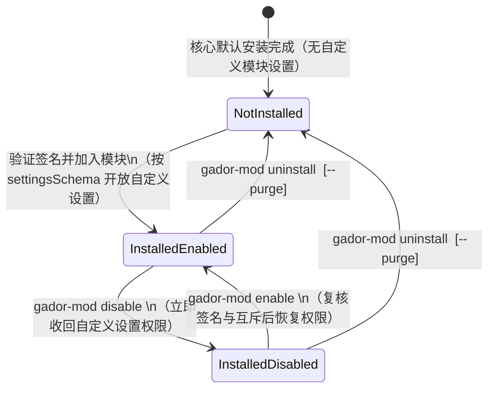

# Gador 可插拔模块架构与动态自定义设置设计

本文档阐述 Gador 核心浏览器与 **独立可安装模块（`modules/`）** 之间的架构边界、生命周期管理、轻量容器隔离以及 **按模块功能动态授予用户自定义设置权限** 的整体设计。

---

## 1. 设计动机与边界原则

1. **最小权限面原则（Least Privilege）**：
   - 核心扩展（`clients/extension/`）仅需 `["alarms", "tabs"]` 与本机 `http://127.0.0.1:43118/*` 权限，负责 AI 标签光效与四引擎新标签页；
   - 任何高权限扩展能力（例如涉及网络出口、反指纹脚本注入、Cookie 策略覆写或自定义安全策略的模块）均与核心浏览器彻底解耦；未加入对应模块时，浏览器进程**完全不加载额外扩展、零全站脚本注入、不暴露多余设置开关**。
2. **模块驱动的用户自定义设置权限（Module-Gated Custom Settings）**：
   - 用户可以自定义与调整模块级设置，**前提是浏览器中已通过签名验证加入了对应模块并处于启用状态**；
   - 设置项完全由该模块 `module.json` 中的 `settingsSchema` 按模块内实际提供的功能动态声明与授权；未声明的键、越界值或相互冲突的设置项均会被服务端与 UI 拦截；模块停用或卸载后，对应设置权限立即收回。
3. **用户显式授权、签名校验与透明整合（不影响普通 Chromium 扩展安装）**：
   - 普通 Chromium 浏览器扩展按常规方式自由安装，不受本模块验证门禁限制；
   - 独立高权限模块（特别是涉及网络出口、指纹防护、DNS 或 Cookie 策略的高敏模块）在加入与加载时强制执行 **三层安全验证**：
     1. **Ed25519 数字签名 + 全文件 SHA-256 完整性校验**（`signature.json` 对应信任密钥环 `modules/trusted-keys.json` + `~/.config/gador/trusted-module-keys.json`，严禁符号链接、未签名文件、多余注入文件或任意字节篡改）；
     2. **一次性人工验证挑战（Challenge-Response）+ 可选本地安装密码锁**（禁止绕过验证的静默安装；如用户配置了 `gador-mod auth set-passphrase`，还须通过 `scrypt` 密码核验）；
     3. **运行时复核与审计日志**（启动挂载扩展与 `gador-mod doctor` 会再次校验已安装目录签名，一旦发现磁盘篡改立即拒绝挂载进 Chromium；全部验证记录写入 `0600` 权限 `~/.config/gador/module-audit.log`）；
   - AI 只能通过只读 `module_list` / `gador://modules` 感知状态，无权静默安装或卸载模块。

---

## 2. 目录结构与注册表模型

```text
modules/
  schema.mjs                          # 模块分类、互斥槽位、生命周期规范与 settingsSchema 校验引擎
  verifier.mjs                        # Ed25519 + 全文件 SHA-256 签名核验、挑战码与密码锁
  secret-vault.mjs                    # AES-256-GCM 仅敏感资料加密密库
  registry.mjs                        # 模块注册表、安装/卸载/启停、自定义设置权限控制与 doctor 校验
  cli.mjs                             # 独立命令行工具 `gador-mod`
  trusted-keys.json                   # 内置受信任发布者公钥环
  sandbox/
    container-manager.mjs             # bubblewrap 轻量命名空间容器管理器（按需启动/空闲回收）
    worker.mjs                        # 容器内受控模块执行器
```

### 2.1 本机持久化状态

- **模块注册表**：`~/.config/gador/modules.json`（权限 `0600`，支持 `GADOR_MODULES_FILE` 覆盖）
- **模块安装根目录**：`~/.config/gador/installed-modules/<moduleId>/`（与只读安装目录物理分离，升级核心浏览器绝不覆盖用户已加入模块；支持 `GADOR_MODULES_DIR` 覆盖）
- **模块自定义设置存储**：`~/.config/gador/module-settings/<moduleId>.json`（权限 `0600`，仅在对应模块已安装且启用时开放读写；支持 `GADOR_MODULE_SETTINGS_DIR` 覆盖）

---

## 3. 模块生命周期与自定义设置权限状态机



各状态下的系统行为：
1. **NotInstalled**：
   - 普通设置页**不展示**该模块的自定义设置项，也不直接提供一键安装按钮；
   - `GET/POST /api/modules/:id/settings` 返回 `409 ERR_MODULE_NOT_INSTALLED`；
   - `gador --desktop` 不挂载该模块扩展。
2. **InstalledEnabled**：
   - 模块通过 Ed25519 + SHA-256 核验并落盘于 `~/.config/gador/installed-modules/<id>/`；
   - 若模块声明了 `settingsSchema`，`GET /api/custom-settings` 与浏览器设置页**自动按模块内功能动态渲染自定义设置卡片**，允许用户修改、校验互斥与恢复默认；
   - 若模块包含 `integration.extensionDir`，`bin/gador --desktop` 启动时通过 `gador-mod extensions` 自动将其拼入 `--load-extension`。
3. **InstalledDisabled**：
   - 保留文件与用户配置，立即暂停自定义设置读写与扩展生效；无其他启用模块时同步回收容器。
4. **Uninstalled**：
   - 移除 `~/.config/gador/installed-modules/<id>/`；默认保留用户配置，加 `--purge` 时一并清除 `module-settings/<id>.json`。

---

## 4. 模块驱动的自定义设置权限与创作者二级菜单（`settingsSchema` + `submenus`）

1. **权限前提**：用户仅对**已安装、已启用且签名完好**的模块享有自定义设置与二级菜单交互权限；
2. **十二大模块种类**：支持 `network`、`privacy`、`identity`、`automation`、`appearance`、`security`、`productivity`、`content`、`developer`、`media`、`data`、`search` 共 12 类模块（详见 `gador-mod spec`）；
3. **创作者自制二级菜单**：每个模块创作者可在 `module.json` 的 `submenus` 中自由设计本模块的二级菜单标签与编排项（支持 `setting` 绑定设置项、`action` 触发 `bubblewrap` 沙箱内方法、`info` 展示只读说明），浏览器设置页全声明式渲染（TrustedTypes 安全）；
4. **功能对齐与冲突硬拦截**：可修改的字段严格受限于该模块 `settingsSchema`（支持 `boolean`、`select`、`number`、`string`）；互斥设置项同时开启将被服务端返回 `409 ERR_SETTING_CONFLICT` 并在 UI 显示 `🚫 冲突禁止`；
5. **统一入口**：支持浏览器设置页动态二级菜单卡片、HTTP API（`GET /api/custom-settings`、`GET/POST/DELETE /api/modules/:id/settings`）与 CLI（`gador-mod settings <id> get|set|reset`）。

> 典型场景举例：网络出口类（如独立 VPN 代理管理）或隐私防护类（如指纹防护）模块均遵循同一套验证、沙箱隔离与按功能动态开放自定义设置的规范；本仓库与发行包不内置此类敏感模块实现，开发者可按 [docs/module-developer-guide.md](module-developer-guide.md) 自行构建与签名接入。

---

## 5. 超轻量级模块隔离容器（`bubblewrap` / 零后台常驻）

为防范第三方自制模块潜藏恶意代码（如窃取 `~/.ssh`、`~/.config/gador/keys`、宿主机环境变量或发起未授权网络请求），Gador 为所有已启用模块内置了 **无守护进程（Daemonless）超轻量级 Linux 内核容器**（[modules/sandbox/container-manager.mjs](../modules/sandbox/container-manager.mjs) 与 [modules/sandbox/worker.mjs](../modules/sandbox/worker.mjs)）：

### 5.1 为什么选用 `bubblewrap (bwrap)` 而非重型 Docker 守护进程
- **零常驻占用**：没有后台常驻容器守护进程，**无模块启用时容器绝对不启动（`state: "STOPPED_IDLE"`，内存占用 `0 bytes`）**；
- **按需懒启动 + 60 秒空闲自动回收**：仅在模块已通过签名验证并启用且收到调用时才按需拉起容器（启动耗时 `< 50 ms`），空闲 60 秒或最后一个模块停用/卸载时立即销毁进程释放全部内存；
- **硬资源上限**：每个模块容器默认限制 V8 堆内存 `64 MiB`（`--max-old-space-size=64`，最高不超过 `128 MiB`）与单次执行 `5000 ms` 强制超时熔断；
- **真 Linux 内核命名空间隔离**：
  - `--unshare-all`（独立 User / PID / Mount / IPC / UTS / Network 命名空间）+ `--cap-drop ALL` + `--die-with-parent` + `--new-session`；
  - `--clearenv` 清空宿主机全部环境变量；
  - 仅以只读方式挂载 `/sandbox/module`（模块自身代码不可自篡改），仅允许写入隔离目录 `/sandbox/data`（`~/.config/gador/sandbox-data/<moduleId>`）与内存 `/tmp`；
  - 宿主机 `$HOME`、`~/.ssh`、`~/.config/gador/keys`、`~/.config/chromium`、`/etc/shadow` 对容器内代码**物理不可见**；
  - 默认彻底断网（不共享网络命名空间），除非模块在 `module.json` 中显式声明 `sandbox.allowNetwork: true`；
  - 无 `bwrap` 环境自动回退至 Node `--permission` 文件系统最小权限沙箱。

---

## 6. 标准 `module.json` 清单规范与用户自制模块开发

Gador 鼓励用户自行制作并整合模块，采用 **「源码与普通配置全明文 + 仅重要敏感凭据 AES-256-GCM 加密（`modules/secret-vault.mjs`）+ 与官方模块完全一致的 Ed25519 验证流程」**。

快速制作命令：
```bash
gador-mod init my-module --dir ./my-module --with-extension
gador-mod keygen --out ~/.config/gador/my-keys --key-id my-dev-v1
gador-mod trust add my-dev-v1 ~/.config/gador/my-keys/my-dev-v1.public.pem
gador-mod sign ./my-module --key ~/.config/gador/my-keys/my-dev-v1.private.pem --key-id my-dev-v1
gador-mod install ./my-module
```

完整开发、加密密库 API 与签名校验排障手册请见：[docs/module-developer-guide.md](module-developer-guide.md)。
