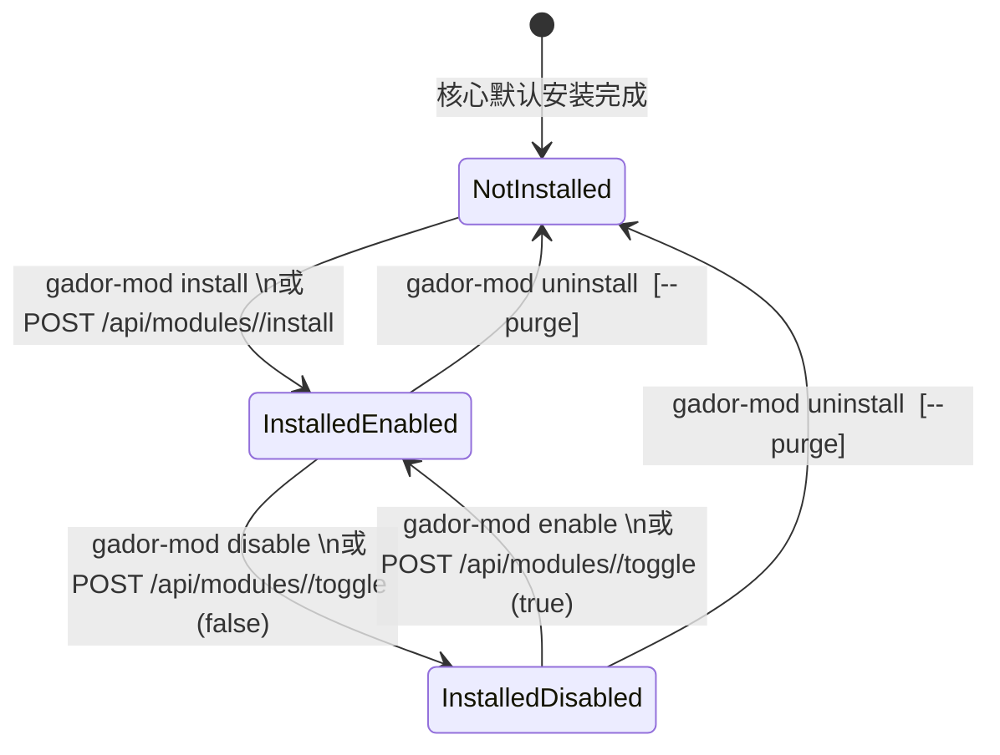

# Gador 可插拔模块设计与整合架构（VPN 与指纹防护）

本文档阐述 Gador 核心浏览器与 **独立可安装模块（`modules/`）** 之间的架构边界、生命周期管理、整合机制以及扩展开发规范。

---

## 1. 设计动机：为什么要把 VPN 与指纹防护解耦为独立模块？

1. **最小权限面原则（Least Privilege）**：
   - 核心扩展（`clients/extension/`）仅需 `["alarms", "tabs"]` 与本机 `http://127.0.0.1:43118/*` 权限，负责 AI 标签光效与四引擎新标签页；
   - 反指纹防护需要 `declarativeNetRequest`、`storage` 与全站 `MAIN` world `document_start` 注入；将其剥离到 `modules/privacy-shield/extension/` 后，未安装模块时浏览器进程**完全不加载该扩展、零全站脚本注入**。
2. **核心稳定与独立演进**：
   - 内核仍保留底层的 `network.setTunnel` / `network.getStatus`（保证高危门禁 P1 WebRTC 防泄漏与 Fail-Closed 基线）；
   - 高层 VPN 档案管理、宿主机代理探测跟随、强制快照备份库以及反指纹策略集均可按模块独立安装、停用、升级与卸载，不影响核心浏览稳定性。
3. **用户显式授权、签名校验与透明整合（仅针对 `vpn` 与 `privacy-shield` 两个高权限模块，不影响普通浏览器扩展安装）**：
   - 普通 Chromium 浏览器扩展（如应用商店扩展）按常规方式自由安装，不受模块验证门禁限制；
   - `vpn` 与 `privacy-shield` 两个独立高权限模块在安装与加载时强制执行 **三层安全验证**：
     1. **Ed25519 数字签名 + 全文件 SHA-256 完整性校验**（`signature.json` 对应信任密钥环 `modules/trusted-keys.json` + `~/.config/gador/trusted-module-keys.json`，严禁符号链接、未签名文件、多余注入文件或任意字节篡改）；
     2. **一次性人工验证挑战（Challenge-Response）+ 可选本地安装密码锁**（WebUI 需先调用 `/install-challenge` 获取 120 秒一次性确认码 `GDR-XXXX`，CLI 需交互输入确认码或显式 `--confirm-digest <sha256前缀>`；如用户配置了 `gador-mod auth set-passphrase`，还须通过 `scrypt` 密码核验）；
     3. **运行时复核与审计日志**（启动挂载扩展与 `gador-mod doctor` 会再次校验已安装目录签名，一旦发现磁盘篡改立即拒绝挂载进 Chromium；全部验证记录写入 `0600` 权限 `~/.config/gador/module-audit.log`）；
   - AI 只能通过只读 `module_list` / `gador://modules` 感知状态，无权静默安装或卸载模块。

---

## 2. 目录结构与注册表模型

```text
modules/
  registry.mjs                        # 模块注册表、安装/卸载/启停、扩展路径解析与 doctor 校验
  cli.mjs                             # 独立命令行工具 `gador-mod`
  vpn/
    module.json                       # VPN 模块清单（UI 槽位、HTTP 路由、MCP 工具、安全边界）
    index.mjs                         # VPN 模块编程入口
    README.md                         # VPN 模块独立安装与使用文档
  privacy-shield/
    module.json                       # 隐私与指纹防护模块清单
    index.mjs                         # 模块编程入口
    README.md                         # 模块独立安装与使用文档
    extension/                        # 独立可挂载 MV3 扩展包
      manifest.json
      background.js                   # 同步 /api/privacy-shield 并维护 Sec-GPC: 1 动态规则
      privacy-shield-bridge.js        # ISOLATED world 配置桥
      privacy-shield-main.js          # MAIN world 反指纹执行引擎（零 window/sessionStorage 痕迹）
```

### 2.1 本机持久化状态

- **模块注册表**：`~/.config/gador/modules.json`（权限 `0600`，支持环境变量 `GADOR_MODULES_FILE` 覆盖以便隔离测试）
- **模块安装根目录**：`~/.config/gador/installed-modules/<moduleId>/`（与只读内置目录 `~/.local/share/gador/modules/` 物理分离，升级核心浏览器绝不覆盖用户已安装模块；支持 `GADOR_MODULES_DIR` 覆盖）

```json
{
  "version": 1,
  "modules": {
    "vpn": {
      "installed": true,
      "enabled": true,
      "version": "0.1.0",
      "installPath": "/home/<user>/.local/share/gador/modules/vpn",
      "source": "builtin-catalog",
      "installedAt": "2026-11-24T06:00:00.000Z",
      "updatedAt": "2026-11-24T06:00:00.000Z"
    },
    "privacy-shield": {
      "installed": true,
      "enabled": true,
      "version": "0.1.0",
      "installPath": "/home/<user>/.local/share/gador/modules/privacy-shield",
      "source": "builtin-catalog",
      "installedAt": "2026-11-24T06:00:00.000Z",
      "updatedAt": "2026-11-24T06:00:00.000Z"
    }
  }
}
```

---

## 3. 模块生命周期状态机



各状态下的系统行为：
1. **NotInstalled**：
   - `Gador 设置` 对应区域展示 **独立模块安装引导卡**（含模块能力说明、CLI 命令与「安装并整合」按钮）；
   - `gador --desktop` 不挂载该模块的扩展包；
   - `POST /api/privacy-shield` 返回 `409 ERR_MODULE_NOT_INSTALLED`，MCP `privacy_shield_set` 返回明确安装提示。
2. **InstalledEnabled**：
   - 模块包已复制至 `~/.local/share/gador/modules/<id>/` 并在 `modules.json` 标记 `enabled: true`；
   - `Gador 设置` 自动解锁完整管理面板，并在底部提供「停用 / 卸载模块」控制条；
   - 若模块包含 `integration.extensionDir`（如 `privacy-shield`），`bin/gador --desktop` 启动时通过 `gador-mod extensions` 自动将其拼入 `--load-extension=<core_ext>,<module_ext>`。
3. **InstalledDisabled**：
   - 保留文件与配置，立即暂停前端管理功能与 API 写入；运行中的 `privacy-shield` 扩展会在 1.8s 内轮询到 `moduleEnabled: false` 并自动卸载 `Sec-GPC` 规则、关闭扰动。
4. **Uninstalled**：
   - 移除 `~/.local/share/gador/modules/<id>/`；默认**保留**用户档案/配置（加 `--purge` 或 `purge: true` 时一并清除）。

---

## 4. 两大官方可选模块详细设计

### 4.1 `vpn` 模块（独立 VPN 与代理管理）

- **清单**：[modules/vpn/module.json](../modules/vpn/module.json)
- **底层依赖**：内核 UDS `network.setTunnel`、`network.getStatus`
- **整合点**：
  - **Settings UI 槽位**：`chrome://settings/gador-vpn`（「网络与独立 VPN」）
  - **数据与备份存储**：`~/.config/gador/vpn/profiles.json` + `~/.config/gador/vpn/backups/*.json`
  - **AI 安全边界**：`editableScope: "vpn_only"`，所有修改与删除均强制先写入时间戳备份，支持一键还原与一键清空
  - **宿主机代理联动**：支持探测环境变量、`gsettings` (GNOME)、`kioslaverc` (KDE) 与本机常见代理端口（`7890` / `7897` / `10808` / `10809` / `2080` / `1080`），开启跟随后自动同步，切回手动隧道时自动停止跟随

### 4.2 `privacy-shield` 模块（隐私与指纹防护）

- **清单**：[modules/privacy-shield/module.json](../modules/privacy-shield/module.json)
- **整合点**：
  - **Settings UI 槽位**：`chrome://settings/privacy`（「隐私与指纹防护」卡片，位于原生 Chromium 隐私选项上方）
  - **独立 MV3 扩展**：`modules/privacy-shield/extension/`
    - `privacy-shield-main.js`：在 `MAIN` world `document_start` 运行，闭包内部生成会话随机种子（不写任何 `window` 属性或 `sessionStorage` 键），覆盖 Canvas 2D / WebGL / AudioContext / DOMRect / `hardwareConcurrency` / `deviceMemory` / `getBattery` / `globalPrivacyControl` / `webdriver`，并通过 `WeakMap` 保持 `Function.prototype.toString` 返回 `[native code]`
    - `privacy-shield-bridge.js`：在 `ISOLATED` world 监听 `chrome.storage.onChanged` 并通过 `CustomEvent` 热同步策略
    - `background.js`：轮询 `GET /api/privacy-shield`，动态注册/移除 `declarativeNetRequest` 的 `Sec-GPC: 1` 请求头规则
  - **AI 环境自检与调试接口**：`privacy_shield_get`、`privacy_shield_set`、`privacy_audit_page`、`gador://privacy-shield`、`debug_environment_privacy` 及 `gador-ctl privacy ...`

---

## 5. 超轻量级模块隔离容器（`bubblewrap` / 零后台常驻）

为防范第三方自制模块潜藏恶意代码（如窃取 `~/.ssh`、`~/.config/gador/keys`、宿主机环境变量或发起未授权网络请求），Gador 为所有已启用模块内置了 **无守护进程（Daemonless）超轻量级 Linux 内核容器**（[modules/sandbox/container-manager.mjs](../modules/sandbox/container-manager.mjs) 与 [modules/sandbox/worker.mjs](../modules/sandbox/worker.mjs)）：

### 5.1 为什么选用 `bubblewrap (bwrap)` 而非重型 Docker 守护进程
- **零常驻占用**：没有后台常驻容器守护进程，**无模块启用时容器绝对不启动（`state: "STOPPED_IDLE"`，内存占用 `0 bytes`）**；
- **按需懒启动 + 60 秒空闲自动回收**：仅在模块已通过签名验证并启用且收到调用时才按需拉起容器（启动耗时 `< 50 ms`），空闲 60 秒或最后一个模块停用/卸载时立即销毁进程释放全部内存；
- **硬资源上限**：每个模块容器默认限制 V8 堆内存 `64 MiB`（`--max-old-space-size=64`，最高不超过 `128 MiB`）与单次执行 `5000 ms` 强制超时熔断；
- **真 Linux 内核命名空间隔离**：
  - `--unshare-all`（独立 User / PID / Mount / IPC / UTS / Network 命名空间）+ `--cap-drop ALL` + `--die-with-parent` + `--new-session`；
  - `--clearenv` 清空宿主机全部环境变量；
  - 仅以只读方式挂载 `/sandbox/module`（模块自身代码不可自篡改），仅允许写入隔离目录 `/sandbox/data`（`~/.config/gador/sandbox-data/<moduleId>`）与内存 `/tmp`；
  - 宿主机 `$HOME`、`~/.ssh`、`~/.config/gador/keys`、`~/.config/chromium`、`/etc/shadow` 对容器内代码**物理不可见**；
  - 默认彻底断网（不共享网络命名空间），除非模块在 `module.json` 中显式声明 `sandbox.allowNetwork: true`；
  - 无 `bwrap` 环境自动回退至 Node `--permission` 文件系统最小权限沙箱。

---

## 6. 标准 `module.json` 清单规范与用户自制模块开发

Gador 鼓励用户自行制作并整合模块，采用 **「源码与普通配置全明文 + 仅重要敏感凭据 AES-256-GCM 加密（`modules/secret-vault.mjs`）+ 与官方模块完全一致的 Ed25519 验证流程」**。

快速制作命令：
```bash
gador-mod init my-module --dir ./my-module --with-extension
gador-mod keygen --out ~/.config/gador/my-keys --key-id my-dev-v1
gador-mod trust add my-dev-v1 ~/.config/gador/my-keys/my-dev-v1.public.pem
gador-mod sign ./my-module --key ~/.config/gador/my-keys/my-dev-v1.private.pem --key-id my-dev-v1
gador-mod install ./my-module
```

完整开发、加密密库 API 与签名校验排障手册请见：[docs/module-developer-guide.md](module-developer-guide.md)。
